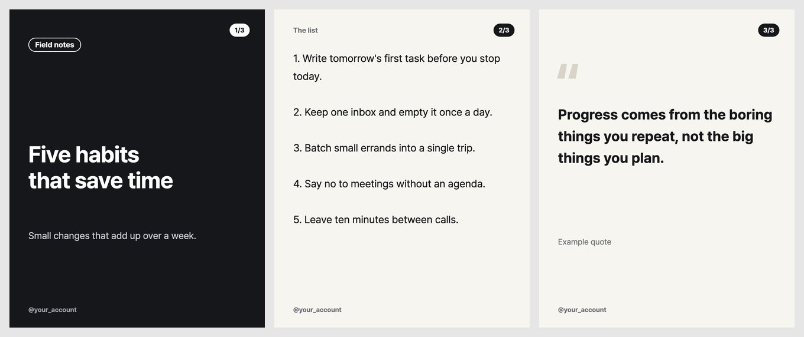
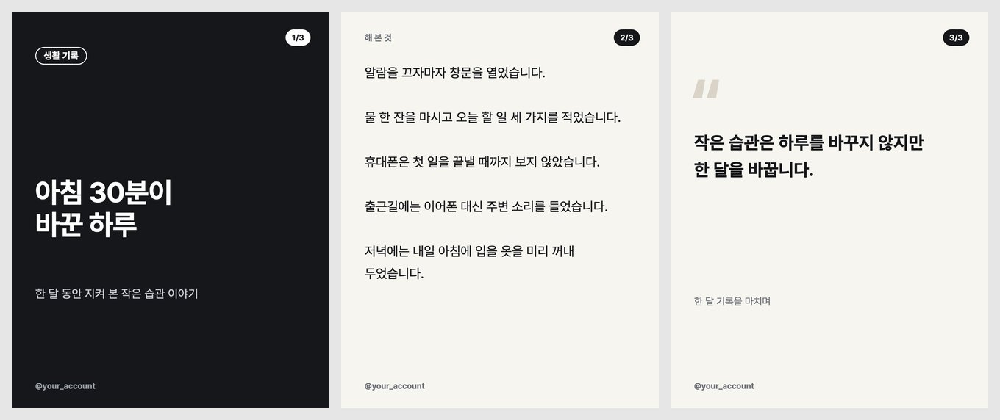

# html-carousel-renderer

**HTML to image carousel generator.** It renders a JSON post and HTML/CSS templates with headless Chromium (Playwright). You get:
- **Instagram carousel** / **card news** images at **4:5, 1080×1350** (JPEG)
- a **9:16 reels / shorts video** of the same pages (MP4 or WebM via ffmpeg)

It does careful text layout for **Korean line breaking** (`word-break: keep-all`) and runs an **overflow check** on every page. A post that would come out with cut-off text, a broken word or overlapping boxes is refused instead of published.




*Example pages from `templates/basic.html`, rendered on macOS with system fonts (no font files are bundled).*

Text layout is checked on every page before it is captured. If anything is wrong, the render **stops** and writes nothing. That covers:
- text that overflows its box
- a word broken across lines
- two text boxes overlapping
- a network request

It was written for Korean text, where "do not break inside a word" (`word-break: keep-all`) matters, but it works for any language.

```
post.json + templates.html ──► headless Chromium ──► page-01.jpg … page-NN.jpg   (4:5)
                                                 └─► story.mp4 / story.webm       (9:16, if ffmpeg is available)
                                                 └─► manifest.json                (pages, sizes, sha256)
```

## Quick start

```sh
npm install                      # playwright-core
npx playwright-core install chromium  # or point CR_CHROME at any Chromium/Chrome build
node src/cli.mjs examples/habits-en.json out/habits
node src/cli.mjs examples/routine-ko.json out/routine
```

Output folder (must not exist yet):

```
out/habits/page-01.jpg  page-02.jpg  page-03.jpg  story.mp4  manifest.json
# story.mp4 needs an ffmpeg with libx264; with VP9 only it is story.webm, without ffmpeg there is no video
```

## Post format

```json
{
  "footer": "@your_account",
  "video": { "hold": 2.5, "slide": 0.3, "background": "#101114" },
  "cards": [
    { "template": "cover", "kicker": "Field notes", "title": "Five habits\nthat save time", "subtitle": "Small changes that add up." },
    { "template": "list",  "label": "The list", "items": "1. First item\n\n2. Second item" },
    { "template": "quote", "quote": "A short quote.", "by": "Who said it" }
  ]
}
```

- Every field is a string. Text is inserted with `textContent`, so HTML in a post is drawn as text, never parsed.
- `\n` starts a new line.
- Fields a template does not declare are rejected.

## Templates

A template file holds one `<template id="tpl-NAME">` per card type. See [`templates/basic.html`](templates/basic.html) (cover, quote, list).

| Attribute | Meaning |
|---|---|
| `data-slot="field"` | Filled with that field of the card. |
| `data-required` | The card must provide this field. |
| `data-split` | Long text in this slot continues on the next page, line by line. One per template. |
| `data-text` | Fixed text that takes part in the overlap check. Add `aria-hidden="true"` to exclude decoration. |
| `page`, `footer` | Filled by the renderer (`"2/5"` and the post's `footer`). |

Give every slot a fixed width and height with `overflow: hidden`. The renderer compares the content size with the box to find overflow. Use `word-break: keep-all; overflow-wrap: normal;`, so a word that cannot fit overflows sideways and is caught instead of being cut.

## Stop rules

The CLI exits with code 2 and prints `RENDER_STOP <CODE>: …`. No output folder is created.

| Code | When |
|---|---|
| `BAD_JSON` | Not JSON, no cards, unknown template or field, a required field missing, a value that is not a string |
| `OVERFLOW` | Text is taller or wider than its box, or one line of a split slot does not fit on an empty page |
| `KEEP_ALL` | A word (between spaces) is drawn on two lines |
| `OVERLAP` | Two visible text boxes overlap |
| `PAGE_COUNT` | Number of pages outside `--min-pages`..`--max-pages` (default 2..20, Instagram's carousel range) |
| `NET_BLOCKED` | The page tried to load anything other than a `data:` URL (the request is aborted inside the browser) |
| `TEMPLATE_NAVIGATION` | The template contains `<meta http-equiv="refresh">` or otherwise navigated or reloaded the page |
| `OUT_EXISTS` | The output folder already exists |
| `VIDEO` | ffmpeg failed |

### Templates are code, posts are data

**Only use templates you trust.** A template is HTML and CSS that the browser renders. The renderer makes that safe enough for templates you wrote yourself:
- Page JavaScript is turned off (`javaScriptEnabled: false`). Scripts in a template do not run, and the renderer's own measuring code runs through Playwright's `page.evaluate`.
- The browser context is offline and WebSockets are refused.
- Every request other than a `data:` URL is aborted, and one blocked request stops the render. Local files (`file:`) are not loaded either: Chromium refuses them for a page that is not itself a file, so a template cannot pull local files into an image (the test checks that the output is unchanged).

Posts (JSON) are data. Text is inserted with `textContent`, values are validated against the template's slots, and file names in the output are fixed (`page-NN.jpg`, `story.*`, `manifest.json`).

## Page splitting

A `data-split` slot is filled line by line and continues on a new page when it no longer fits. Blank lines at the top of a page are dropped.

If the last page would have fewer than `--min-tail-lines` (default 4) rendered lines, lines move from the previous page. This keeps a lone line or two from ending the carousel. Line counts come from the text's own line boxes, not from the box height.

## Video

Each page is shown centered on a 1080×1920 background with a progress bar. A page holds `hold` seconds, followed by an eased `slide` to the next page.

Limits accepted from a post (outside them → `BAD_JSON`):
- `hold`: 0.5–10 seconds
- `slide`: 0–1 second, and shorter than `hold`
- `background`: a hex colour such as `#101114`

The format depends on what ffmpeg (`CR_FFMPEG`, default `ffmpeg` on `PATH`) can encode:

| ffmpeg has | Output |
|---|---|
| `libx264` | MP4 |
| `libvpx-vp9` only | WebM |
| no ffmpeg | no video (images and manifest only) |

There is no audio track. `--no-video` skips the video.

## manifest.json

```json
{ "tool": "html-carousel-renderer", "version": "0.1.0", "pages": 3,
  "images": [ { "file": "page-01.jpg", "template": "cover", "card": 0, "width": 1080, "height": 1350, "sha256": "…" } ],
  "video": { "file": "story.mp4", "width": 1080, "height": 1920, "fps": 30, "frames": 210, "seconds": 7, "format": "mp4", "audio": null, "sha256": "…" },
  "checks": { "overflow": 0, "keep_all": 0, "overlap": 0, "network_blocked": 0, "page_count": "2..20", "min_tail_lines": 4 }, "ms": 2600 }
```

## Options and environment

| | |
|---|---|
| `--templates file.html` | Template file (default `templates/basic.html`) |
| `--min-pages n`, `--max-pages n` | Allowed page count |
| `--min-tail-lines n` | Minimum lines on the last page of a split slot (0 turns it off) |
| `--no-video` | Images and manifest only |
| `CR_CHROME` | Path to a Chromium/Chrome executable (otherwise Playwright's default) |
| `CR_PLAYWRIGHT_CORE_DIR` | A folder that contains `playwright-core`, if it is not installed next to this package |
| `CR_FFMPEG` | ffmpeg binary |

Library use: `import { render } from "html-carousel-renderer"`. It takes `{ post, templatesHtml, outDir, chrome, ffmpeg, minPages, maxPages, minTailLines, video }`, returns the manifest, and throws `RenderStop` (with `.code`).

## Running the tests

```sh
npm install && npx playwright-core install chromium && npm test
# or with an existing browser / playwright-core:
CR_CHROME=/path/to/chrome CR_PLAYWRIGHT_CORE_DIR=/path/to/node_modules npm test
```

There are 23 tests (`node:test`, no other test dependency):
- both examples render
- page splitting with the last-page rule on and off
- each stop code, including non-string values, a line too long for an empty page, video limits and built-in names such as `__proto__`
- HTML in a post is drawn as text with no request
- a template that loads a remote image is blocked
- template scripts reach nothing: WebSocket, `sendBeacon` and `fetch` to a local test server arrive 0 times, and a script that would change the page has no effect
- a template cannot load `file:` URLs
- a missing output parent fails before a browser starts
- a meta refresh (plain, delayed, written with a character reference) stops the render
- a real SIGINT during a render removes the `.tmp-*` folder
- an ordinary error is reported as an error, not as `TEMPLATE_NAVIGATION`

## Limits

- **A headless Chromium is required.** Rendering is done by a real browser engine.
- **Fonts are your responsibility.** No font files are bundled. The templates list Pretendard, Noto Sans CJK KR, Apple SD Gothic Neo, Inter and system fonts, and the first installed one is used. A different font changes line breaks and page splits, so run the tests with the font you deploy.
- **ffmpeg is optional.** Without `libx264` you get WebM, not MP4. The MP4 path was not exercised on the machine where this was written: its ffmpeg had only VP9.
- Checks cover layout, not meaning. Contrast, spelling and whether the text is appropriate are not checked.
- One `data-split` slot per template.
- Interrupting the CLI (Ctrl-C, SIGTERM) removes its temporary `.tmp-*` folder. If the process is killed hard (`kill -9`), delete the `.tmp-*` folder next to the output folder yourself.
- No `package-lock.json` is shipped yet. The only dependency is `playwright-core`, pinned to an exact version in `package.json`.

## 한국어 요약

**html-carousel-renderer** 는 JSON 글과 HTML/CSS 템플릿으로 **인스타그램 캐러셀·카드뉴스 이미지(4:5, 1080×1350 JPEG)**와 **9:16 릴스·쇼츠 영상**을 만드는 도구입니다. 헤드리스 크로미움(Playwright)으로 그립니다.

- **한글 줄바꿈**: `word-break: keep-all` 로 낱말 중간에서 줄이 바뀌지 않게 하고, 그래도 낱말이 갈리면(`KEEP_ALL`) 렌더를 멈춥니다.
- **넘침·겹침 검사**: 글이 칸을 넘치거나(`OVERFLOW`) 글 상자끼리 겹치면(`OVERLAP`) 멈춥니다. 멈추면 결과 폴더를 만들지 않습니다.
- **장 나눔**: 긴 목록은 다음 장으로 넘기고, 마지막 장에 한두 줄만 남지 않게 앞 장에서 줄을 옮깁니다.
- **바깥 요청 차단**: 페이지 자바스크립트를 끄고, 브라우저를 오프라인으로 두고, `data:` 말고는 모든 요청을 브라우저 안에서 끊습니다. 끊긴 요청이 있으면 멈춥니다(`NET_BLOCKED`). 템플릿은 코드이므로 믿는 템플릿만 쓰세요.
- **결과**
  - 장마다 JPEG
  - 9:16 영상(ffmpeg 가 있으면 MP4, VP9 만 있으면 WebM)
  - 장 수와 sha256 을 담은 `manifest.json`
- 글꼴 파일은 넣지 않았습니다. Pretendard·Noto Sans CJK KR 같은 글꼴을 직접 설치해 쓰세요. 글꼴이 바뀌면 줄바꿈과 장 나눔도 바뀝니다.
- 예시: `examples/routine-ko.json`(한국어), `examples/habits-en.json`(영어).

## License

MIT — see [LICENSE](LICENSE). Security reports: see [SECURITY.md](SECURITY.md).
